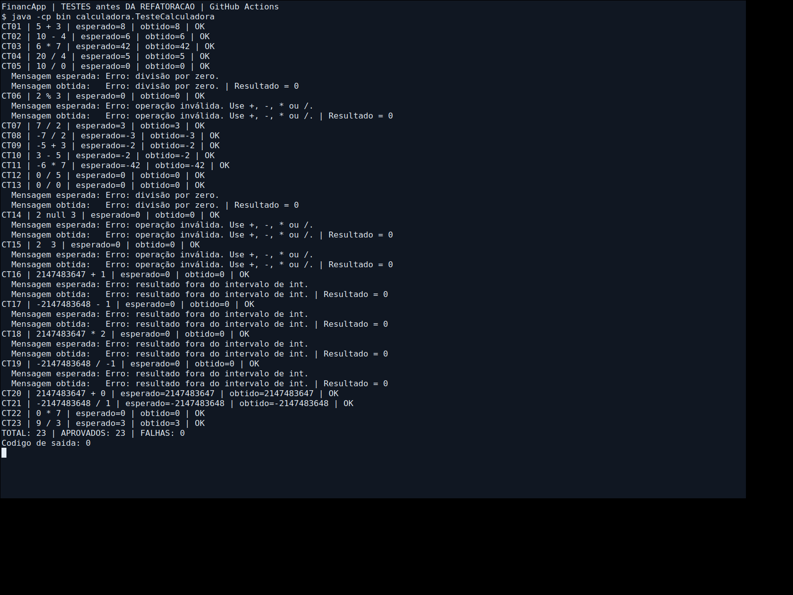
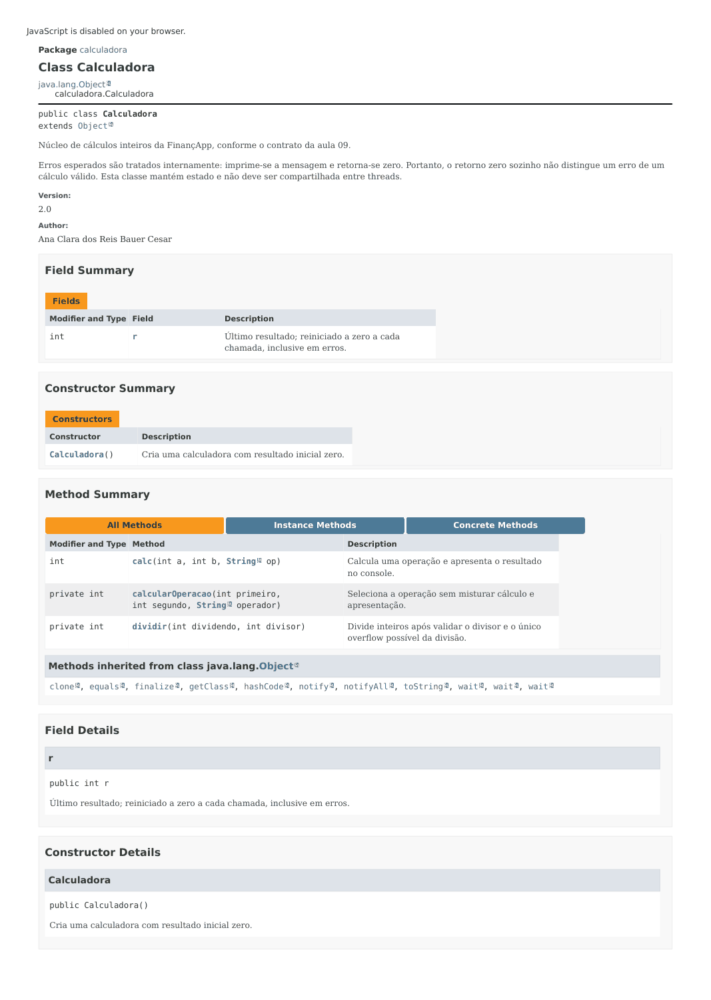

# Projeto Calculadora — FinançApp

> Projeto acadêmico com foco em Qualidade de Software, Testes, Refatoração, Documentação e Versionamento.

## 1. Identificação do Projeto

**Projeto:** projeto_calculadora  
**Contexto:** FinançApp  
**Aluna:** Ana Clara dos Reis Bauer Cesar  
**RA:** 252578  
**Curso:** Análise e Desenvolvimento de Sistemas — FACENS  
**Disciplina:** UX/UI e Testes de Software  
**Professor:** Daniel Ohata  
**Semestre:** 2026.2

## 2. Visão Geral

Módulo Java de operações com inteiros para a startup fictícia FinançApp, como exercício de controle de orçamento, divisão de despesas e projeção de economia. O projeto inclui testes automatizados, tratamento de erros, uma interface de console e documentação HTML.

## 3. Problema

Um módulo reutilizável precisa calcular corretamente e continuar operando depois de entradas inválidas. Código organizado, testes reproduzíveis e documentação reduzem o risco de regressões durante a manutenção.

## 4. Objetivo

### 4.1 Objetivo Geral

Construir, validar, refatorar e documentar uma calculadora Java com controle de versões.

### 4.2 Objetivos Técnicos

- Implementar as quatro operações e tratar erros previsíveis.
- Comparar resultados e mensagens com expectativas independentes.
- Refatorar em uma branch própria sem alterar o comportamento.
- Gerar JavaDoc e registrar evidências de execução.

## 5. Escopo Funcional

| ID | Funcionalidade | Exemplo | Status |
|---|---|---|---|
| RF01 | Soma | `5 + 3 = 8` | Testado |
| RF02 | Subtração | `10 - 4 = 6` | Testado |
| RF03 | Multiplicação | `6 * 7 = 42` | Testado |
| RF04 | Divisão inteira | `20 / 4 = 5`; `7 / 2 = 3` | Testado |
| RF05 | Divisão por zero | Mensagem de erro e retorno 0 | Testado |
| RF06 | Operador inválido | Mensagem de erro e retorno 0 | Testado |

O método obrigatório é `public int calc(int a, int b, String op)`. O atributo público `r` segue o exemplo da aula e armazena o último resultado. Em erro, é reiniciado para zero. Operador nulo ou vazio também é inválido. Operadores com espaços não são normalizados pelo núcleo.

**Contrato da aula:** divisão inteira com truncamento em direção a zero (`-7 / 2 = -3`); erros imprimem mensagem e retornam zero. O retorno zero não distingue sozinho um erro de um resultado válido. Overflow também é tratado para evitar resultados incorretos por estouro de inteiro. A classe mantém estado e não é segura para acesso concorrente.

**Limite do exercício:** não é um motor financeiro de produção. Valores monetários fracionários e regras de arredondamento exigiriam outro contrato, por exemplo com `BigDecimal`.

## 6. Requisitos Não Funcionais

| ID | Categoria | Implementação |
|---|---|---|
| RNF01 | Legibilidade | Nomes descritivos, indentação e métodos pequenos |
| RNF02 | Testabilidade | 23 casos automatizados com verificações reais |
| RNF03 | Manutenção | Mesmos testes antes e depois da refatoração |
| RNF04 | Documentação | JavaDoc de classes, atributos, métodos, parâmetros, retornos e exceções internas |
| RNF05 | Versionamento | Branches `main` e `Refatoracao`, commits por etapa |
| RNF06 | Confiabilidade | Tratamento de erros de operação e entrada no console |

## 7. Tecnologias Utilizadas

| Tecnologia | Versão | Utilização |
|---|---|---|
| Java / OpenJDK | 17 (validado em 17.0.20) | Compilação e execução |
| Testes Java | Executor próprio | Asserções sem dependências, conforme a abordagem da aula |
| Git e GitHub | — | Histórico e repositório remoto |
| JavaDoc | 17 | Documentação HTML |
| Editor/IDE | Livre | Compatível com VS Code, Eclipse e IntelliJ |

JUnit não é necessário nesta implementação. O executor compara retorno, atributo e saída completa; lança `AssertionError` ao final se houver falhas, produzindo código de saída diferente de zero. Não depende da opção `-ea`.

## 8. Estrutura do Projeto

```text
projeto_calculadora/
├── src/calculadora/
│   ├── Calculadora.java
│   └── Main.java
├── test/calculadora/TesteCalculadora.java
├── docs/index.html
├── images/
│   ├── testes/
│   └── javadoc/
├── evidencias/
│   ├── testes-antes.txt
│   ├── testes-depois.txt
│   └── console.txt
├── testar.bat
├── testar.sh
├── gerar-docs.bat
├── gerar-docs.sh
├── .gitignore
└── README.md
```

## 9. Como executar

Instale o **JDK 17 ou superior** e confirme `java -version` e `javac -version` no terminal.

```bash
git clone https://github.com/anachxz/projeto_calculadora.git
cd projeto_calculadora
```

No Windows (Prompt de Comando):

```bat
testar.bat
java -cp bin calculadora.Main
```

No PowerShell, execute `./testar.bat`. No Linux/macOS:

```bash
sh testar.sh
java -cp bin calculadora.Main
```

Ou compile e execute manualmente, na raiz do projeto:

```bash
javac -encoding UTF-8 -Xlint:all -d bin src/calculadora/*.java test/calculadora/*.java
java -cp bin calculadora.TesteCalculadora
java -cp bin calculadora.Main
```

No console, digite `5 + 3` e pressione Enter. Use espaços entre os três elementos. Digite `sair` para encerrar. Após `10 / 0`, o programa permite calcular novamente. Entradas como `abc + 3` e linhas malformadas recebem mensagem sem encerrar o laço.

## 10. Testes e evidências

Foram executados **23 casos, todos aprovados, antes e depois da refatoração**. Cada linha registra ID, entrada, esperado, obtido e status; casos de erro também mostram a mensagem esperada e a obtida. A saída completa das duas versões foi comparada e é idêntica.

| Casos | Cobertura funcional |
|---|---|
| CT01–CT04 | Quatro operações básicas |
| CT05–CT06 | Divisão por zero e operador não suportado |
| CT07–CT12 | Divisão truncada, negativos e resultado zero |
| CT13–CT15 | Zero dividido por zero, operador nulo e vazio |
| CT16–CT19 | Overflow nas quatro operações |
| CT20–CT22 | Limites válidos de int e multiplicação por zero |
| CT23 | Nova operação válida após erros, na mesma instância |

Registros completos: [antes](evidencias/testes-antes.txt), [depois](evidencias/testes-depois.txt) e [execução do console](evidencias/console.txt).

As imagens abaixo são renderizações dos registros reais de execução, não capturas do terminal. Para atender literalmente ao requisito de prints da atividade, substitua-as por capturas do seu terminal após executar `testar.bat`.




Os casos são unitários por exercitarem diretamente `Calculadora`. A seleção usa requisitos funcionais e conhecimento dos caminhos internos (caixa branca). A execução de `Main` complementa com um cenário de integração entre entrada, cálculo e apresentação. Não foi medido percentual de cobertura com ferramenta; aprovação dos casos não garante ausência de todos os defeitos.

## 11. Refatoração e versionamento

A implementação inicial utiliza uma sequência `if/else`. Na branch **Refatoracao**, a seleção foi convertida em `switch`, a divisão foi extraída para `dividir` e o despacho para `calcularOperacao`. Os nomes internos passaram a indicar o papel de cada operando.

A assinatura pública, o atributo `r`, as mensagens e os retornos foram preservados. Os 23 casos não foram alterados entre as versões. A interface `Main` foi acrescentada posteriormente, em etapa separada.

- [Versão inicial testada](https://github.com/anachxz/projeto_calculadora/tree/c783b53a5e73130639e7af9862c6d5d2396e079a)
- [Commit da refatoração](https://github.com/anachxz/projeto_calculadora/commit/b38a11012d81fe9deff396d72ad195a872a24239)
- [Branch Refatoracao](https://github.com/anachxz/projeto_calculadora/tree/Refatoracao)

A versão final é integrada à `main`, preservando a branch `Refatoracao` e o histórico anterior.

## 12. Documentação JavaDoc

A pasta `docs/` contém a documentação gerada, incluindo `index.html`. Depois de clonar ou baixar e extrair o projeto, abra esse arquivo no navegador. O GitHub mostra o código HTML; isso não significa que o JavaDoc esteja publicado como site.

Para regenerar: `gerar-docs.bat` no Windows, ou `sh gerar-docs.sh` no Linux/macOS.

```bash
javadoc -quiet -Xdoclint:all -private -author -version -encoding UTF-8 -docencoding UTF-8 -charset UTF-8 -d docs src/calculadora/*.java test/calculadora/*.java
```

A opção `-private` inclui atributos e métodos auxiliares, com suas exceções documentadas. `calc` captura as exceções esperadas internamente; os métodos privados documentam `@throws` para os erros que lançam.

A imagem abaixo é uma renderização estática do HTML gerado. Para a entrega, acrescente uma captura de `docs/index.html` aberto no seu navegador.



## 13. Repositório e referências

**Repositório:** https://github.com/anachxz/projeto_calculadora

Estrutura das seções 1 a 8 adaptada do [modelo de README indicado na atividade](https://github.com/dr-ohata/calculadora_refatoracao/blob/main/README.md), consultado em 26/10/2026. Referências da disciplina: aula 09 (refatoração e documentação), aula 10 (caixa branca) e aula 11 (caixa cinza).

A aluna deve revisar, executar e compreender o código para apresentar o trabalho individualmente.
